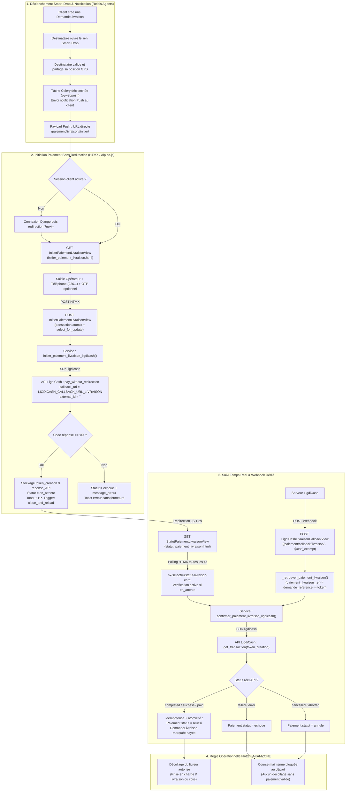

# Architecture & Mind Map : Paiement Livraison LigdiCash — BAKAMZONE

* **Branche Git** : `feature/PaiementLivraisonLigdiCash`
* **Application principale** : `paiement_app` (couplée à `demande_livraison_app`, `livreurs_app` et Celery/WebPush)
* **Date** : 25 novembre 2026 — 10:55 GMT

---

## 1. Mind Map Complète du Flux (Smart-Drop $\rightarrow$ Push Celery $\rightarrow$ LigdiCash $\rightarrow$ Décollage Livreur)

---

## 2. Cartographie des Fichiers & Responsabilités

| Fichier | Rôle & Responsabilité |
| :--- | :--- |
| `paiement_app/models.py` | Modèle **`PaiementLivraisonLigdiCash`** (`OneToOneField` avec `on_delete=models.PROTECT` et `related_name="paiement_livraison_ligdicash"`, `reference` UUID, `token_creation`, `token_callback`, `reponse_API`, index SQL). |
| `paiement_app/services_livraison.py` | Logique métier pure et appels SDK `ligdicash` : `initier_paiement_livraison_ligdicash()` (utilisant `LIGDICASH_CALLBACK_URL_LIVRAISON`) et `confirmer_paiement_livraison_ligdicash()` (verrouillage pessimiste + idempotence). |
| `paiement_app/views_livraison.py` | Contrôleurs dédiés au flux livraison : `InitierPaiementLivraisonView`, `StatutPaiementLivraisonView` et webhook isolé `LigdiCashLivraisonCallbackView` (`@csrf_exempt`). |
| `paiement_app/urls.py` | Routes dédiées : `livraison/<uuid:reference>/initier/`, `livraison/<uuid:reference>/statut/`, et `callback/livraison/`. |
| `templates/paiement_templates/initier_paiement_livraison.html` | Formulaire Mobile Money (charte `#059669` / `#F97316`, HTMX + Alpine.js, injection toast `#toast-container` + redirection sur `close_and_reload`). |
| `templates/paiement_templates/statut_paiement_livraison.html` | Page de suivi avec polling HTMX toutes les 4s (`hx-select="#statut-livraison-card"`) tant que `statut == "en_attente"`. |

---

## 3. Mécanique Interne Détaillée

### A. Séparation stricte Commande vs Livraison
* **Modèle dédié** : `PaiementLivraisonLigdiCash` évite tout champ nullable croisé avec `PaiementLigdiCash` (dédié à `panier_app.Commande`).
* **Webhook dédié (`LIGDICASH_CALLBACK_URL_LIVRAISON`)** : `LigdiCashLivraisonCallbackView` écoute exclusivement `/paiement/callback/livraison/`, évitant toute collision d'identifiants ou d'aiguillage avec `/paiement/callback/ligdicash/`.

### B. Garanties Transactionnelles & Idempotence
1. **Verrouillage concurrentiel (`select_for_update`)** : Dans `InitierPaiementLivraisonView.post` et `confirmer_paiement_livraison_ligdicash`, les lignes `PaiementLivraisonLigdiCash` et `DemandeLivraison` sont verrouillées dans `@transaction.atomic` pour neutraliser les accès concurrents (webhook simultané au polling client).
2. **Vérification serveur-à-serveur** : Le webhook ne valide jamais un paiement sur la seule foi du payload entrant ; il interroge systématiquement `ligdicash.get_transaction(token=paiement.token_creation)`.
3. **Idempotence** : Si `paiement.statut == PaiementLivraisonLigdiCash.STATUT_REUSSI`, toute relance du webhook ou du polling met uniquement à jour les traces d'audit sans ré-exécuter les transitions métier.

---

## 4. Cahier des Charges pour le Relais des Agents (`pywebpush` & Garde-fou Flotte)

1. **Tâche Celery `pywebpush` post-`Smart-Drop`** :
   * Déclencher la notification push au client (`demande_livraison.client.user`) dès l'enregistrement de la position GPS du destinataire.
   * Injecter l'URL cible générée via `reverse("paiement_app:initier_livraison", kwargs={"reference": demande.reference})`.
2. **Garde-fou côté Livreur (`livreurs_app` / `demande_livraison_app`)** :
   * Vérifier avant toute transition vers le statut *en route / récupération / décollage* que le paiement de la course est validé (`paiement_livraison_ligdicash.statut == "reussi"`).