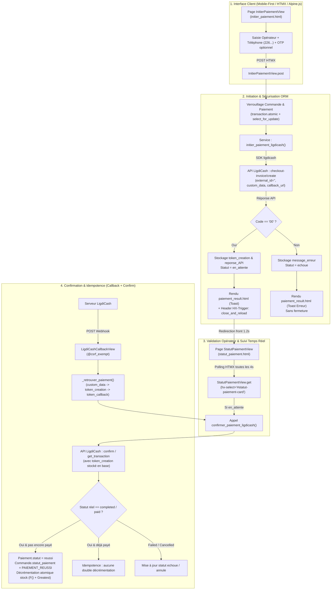

# Architecture & Workflow de Paiement LigdiCash (Payin sans redirection) — BAKAMZONE

Ce document détaille l'architecture complète, le flux de données (mind map) et le fonctionnement interne des modules conçus dans `paiement_app` pour encaisser les commandes via LigdiCash sans quitter l'interface BAKAMZONE.

---

## 1. Mind Map du Workflow de Paiement



---

## 2. Architecture des Fichiers (`paiement_app`)

| Fichier | Rôle principal |
| :--- | :--- |
| `paiement_app/models.py` | Modèle `PaiementLigdiCash` (liaison `OneToOne` avec `Commande`, séparation `token_creation` / `token_callback`, audit `reponse_API`, indexation). |
| `paiement_app/services.py` | Logique métier pure et appels au SDK officiel `ligdicash` (`initier_paiement_ligdicash`, `confirmer_paiement_ligdicash`), atomicité et décrémentation de stock. |
| `paiement_app/views.py` | Contrôleurs légers (`InitierPaiementView`, `LigdiCashCallbackView`, `StatutPaiementView`) et rendu des fragments HTMX. |
| `paiement_app/urls.py` | Routage par `uuid:reference` de commande et endpoint webhook `/paiement/callback/ligdicash/`. |
| `templates/paiement_templates/initier_paiement.html` | Formulaire dynamique Alpine.js + HTMX (formatage numéro, gestion OTP, palette Émeraude `#059669` / Orange `#F97316`). |
| `templates/paiement_templates/statut_paiement.html` | Écran de suivi avec polling HTMX automatique (`every 4s`) tant que le statut est `en_attente`. |
| `templates/partials/result/paiement_result.html` | Toast DaisyUI injecté dans `#toast-container` de `base.html`. |

---

## 3. Explication Détaillée des Composants & Fonctions Internes

### A. Modèle de données (`PaiementLigdiCash`)
* **`reference` (`UUIDField`)** : Identifiant public unique non séquentiel transmis dans `custom_data` pour éviter toute énumération.
* **`commande` (`OneToOneField` vers `panier_app.Commande` avec `on_delete=models.PROTECT`)** : Garantit qu'une commande ne possède qu'une seule fiche de paiement active et empêche toute suppression accidentelle d'une commande liée à un paiement.
* **`token_creation` vs `token_callback`** : Conformément aux contraintes de sécurité LigdiCash, le token retourné à l'initiation est différent de celui envoyé dans le webhook. `token_creation` est conservé précieusement pour interroger l'endpoint de confirmation.
* **`reponse_API` (`JSONField`)** : Conserve l'historique technique complet (`raw` à l'initiation, `last_callback` à la réception webhook, `confirm` lors de la vérification serveur).
* **Indexation (`models.Index`)** : Indexation explicite sur `token_creation` et `statut` pour garantir des recherches instantanées lors des callbacks et des filtrages administratifs.

### B. Couche Service (`paiement_app/services.py`)

#### 1. `_configurer_sdk()`
Initialise les identifiants globaux du package officiel `ligdicash` (`api_key`, `auth_token`, `platform`) à partir de `django.conf.settings`.

#### 2. `initier_paiement_ligdicash(paiement: PaiementLigdiCash, otp: str = "") -> dict`
* Instancie `ligdicash.Invoice` avec le montant, la description et le numéro mobile money formaté (`226XXXXXXXX`).
* Appelle `invoice.pay_without_redirection(...)` en imposant `external_id=""` (règle obligatoire LigdiCash pour le payin sans redirection) et en passant `custom_data={"commande_reference": ..., "paiement_ref": ...}`.
* Si `response_code == "00"`, enregistre `token_creation`, passe le statut à `en_attente` et retourne `{"ok": True, ...}`. Sinon, bascule en `echoue` avec le message explicatif de l'opérateur.

#### 3. `confirmer_paiement_ligdicash(paiement_id: int, token_callback: str = "", payload_cb: dict | None = None) -> PaiementLigdiCash`
* **Verrouillage concurrentiel** : Exécutée sous `@transaction.atomic` avec `select_for_update()` sur `PaiementLigdiCash` et `Commande`. Cela empêche deux requêtes simultanées (ex. un callback + un polling utilisateur) de traiter la validation en parallèle.
* **Vérification serveur-à-serveur** : Appelle `ligdicash.get_transaction(paiement.token_creation)` pour obtenir le statut réel auprès de LigdiCash plutôt que de faire confiance au payload brut du webhook.
* **Idempotence & Décrémentation atomique du stock** :
  * Vérifie `if commande.statut_paiement != Commande.PAIEMENT_REUSSI:`. Si la commande est déjà payée, la fonction s'arrête proprement sans re-décrémenter les stocks.
  * Pour chaque ligne de commande d'article hors bloc (`not ligne.article.en_bloc`), exécute une mise à jour SQL atomique :
    ```python
    Article.objects.filter(pk=ligne.article_id).update(
        quantite_disponible=Greatest(F("quantite_disponible") - ligne.quantite, 0)
    )
    ```

### C. Vues & Helpers (`paiement_app/views.py`)

* **`render_paiement_result(...)`** : Helper centralisé qui rend le fragment `partials/result/paiement_result.html` et injecte l'en-tête HTTP `HX-Trigger: close_and_reload` uniquement lorsque l'opération doit fermer le contexte courant et rediriger vers le suivi.
* **`InitierPaiementView`** :
  * `GET` : Vérifie que la commande appartient bien au client connecté (`client__user=request.user`) et affiche le formulaire pré-rempli.
  * `POST` : Verrouille la commande, valide la présence du numéro, délègue à `initier_paiement_ligdicash` et retourne le toast HTMX.
* **`_extraire_payload_callback(request)` & `_retrouver_paiement(payload)`** :
  * Parse le corps JSON (avec repli sur `request.POST` si nécessaire).
  * Retrouve la transaction selon une cascade résiliente : `custom_data.paiement_ref` $\rightarrow$ `custom_data.commande_reference` $\rightarrow$ `token_creation` $\rightarrow$ `token_callback`.
* **`LigdiCashCallbackView`** : Vue exemptée de CSRF (`@csrf_exempt`) qui reçoit les notifications serveur de LigdiCash et délègue systématiquement la validation à `confirmer_paiement_ligdicash`.
* **`StatutPaiementView`** :
  * Sert le fragment HTML `#statut-paiement-card` pour le polling HTMX toutes les 4 secondes tant que `paiement.statut == "en_attente"`, tout en déclenchant une vérification de statut non bloquante.
  * Conserve une sortie JSON explicite uniquement via `?format=json`.

---

## 4. Règles d'Or à Respecter pour la Suite

1. **Ne jamais supprimer `external_id=""`** dans les appels payin sans redirection LigdiCash.
2. **Toujours utiliser `token_creation`** pour interroger l'état d'une transaction (`get_transaction` / `confirm`), jamais le token du webhook.
3. **Rester strictement idempotent** sur toute action déclenchée au passage à `PAIEMENT_REUSSI` (stock, notifications push, écritures comptables).