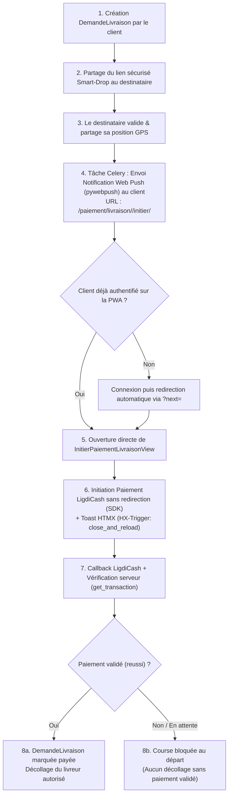

# Workflow Complet : `feature/PaiementLivraisonLigdiCash` — BAKAMZONE

* **Branche Git** : `feature/PaiementLivraisonLigdiCash`
* **Application cible** : `paiement_app` (en interaction avec `demande_livraison_app`, `livreurs_app` et le système de notifications Web Push / Celery)
* **Date de mise à jour** : 23 novembre 2026 — 14:20 GMT
* **Objectif** : Automatiser le déclenchement du paiement de livraison dès le partage de position GPS par le destinataire (`Smart-Drop`), notifier le client via **Web Push (`pywebpush` + Celery)** avec un lien direct vers la page d'initiation de paiement LigdiCash sans redirection, et conditionner strictement le **décollage du livreur** à la validation effective du paiement.

---

## 1. Chaîne Métier Complète : Smart-Drop $\rightarrow$ Push Celery $\rightarrow$ LigdiCash $\rightarrow$ Décollage Livreur



### Règles de gestion & gouvernance opérationnelle BAKAMZONE
1. **Déclenchement par le partage de position (`Smart-Drop`)** : Tant que le destinataire n'a pas partagé sa position GPS, le tarif final de course n'est pas déclenché pour paiement. Dès soumission de la position, la `DemandeLivraison` enregistre les coordonnées et déclenche la tâche Celery de notification.
2. **Notification Push (`pywebpush` + Celery) avec lien direct** : La tâche asynchrone Celery envoie une notification push au client expéditeur contenant le lien exact d'initiation du paiement (`reverse("paiement_app:initier_livraison", kwargs={"reference": demande.reference})`).
3. **Continuité d'authentification (`?next=`)** : Si la session PWA du client a expiré au moment du clic sur la notification push, `LoginRequiredMixin` redirige vers la connexion en conservant le paramètre `next` afin de ramener le client immédiatement sur l'écran de paiement.
4. **Règle ferme « Paiement avant décollage »** : BAKAMZONE opère avec une structure professionnelle (flotte interne et administrateurs de bloc aux rôles spécialisés : gestionnaire de stock, superviseur de flotte, assistant, responsable de bloc). Le règlement préalable de la course est non négociable : tant que `paiement_ligdicash.statut != "reussi"`, le livreur ne décolle pas.

---

## 2. Architecture & Modélisation des Données (`paiement_app/models.py`)

Pour isoler proprement les paiements de courses des commandes e-commerce (`PaiementLigdiCash`), un modèle dédié est mis en place :

### Modèle `PaiementLivraisonLigdiCash`
* **`reference`** : `UUIDField(default=uuid.uuid4, unique=True, editable=False)` — Identifiant public sécurisé transmis dans `custom_data`.
* **`demande`** : `OneToOneField("demande_livraison_app.DemandeLivraison", on_delete=models.PROTECT, related_name="paiement_ligdicash")` — Garantit une fiche de paiement unique par demande de livraison.
* **`montant`** : `DecimalField(max_digits=12, decimal_places=2)` — Montant de livraison figé au moment de l'initiation.
* **`numero_client`** : `CharField(max_length=20)` — Numéro Mobile Money formaté (`226XXXXXXXX`).
* **`operateur`** : `CharField(max_length=30, blank=True)` — Opérateur choisi (`ORANGE`, `MOOV`, `CORIS`, `LIGDICASH`).
* **`statut`** : `CharField(max_length=20, choices=STATUT_CHOICES, default="en_attente")` — États : `en_attente`, `reussi`, `echoue`, `annule`.
* **`token_creation`** : `CharField(max_length=255, blank=True, null=True)` — Token retourné par LigdiCash à l'initiation (utilisé pour `get_transaction` / `confirm`).
* **`token_callback`** : `CharField(max_length=255, blank=True, null=True)` — Token reçu lors du webhook.
* **`reponse_API`** : `JSONField(default=dict, blank=True)` — Journalisation complète des échanges (`init`, `last_callback`, `confirm`).
* **`message_erreur`** : `TextField(blank=True, null=True)` — Message d'erreur lisible en cas d'échec opérateur.
* **`date_creation` / `date_mise_a_jour` / `date_paiement`** : Horodatages complets.
* **Indexation (`Meta.indexes`)** :
  * `models.Index(fields=["token_creation"])`
  * `models.Index(fields=["statut"])`

---

## 3. Logique Métier, Notifications Push Celery & Services

### A. Tâche Celery Web Push post-`Smart-Drop`
* **Déclencheur** : Validation des coordonnées GPS de livraison par le destinataire sur la vue `Smart-Drop`.
* **Exécution Celery (`pywebpush`)** :
  * Récupère les abonnements Web Push actifs de `demande.client.user`.
  * Construit l'URL de paiement : `url_paiement = reverse("paiement_app:initier_livraison", kwargs={"reference": demande.reference})`.
  * Envoie le payload JSON au Service Worker (`sw.js`) :
    ```json
    {
      "title": "Position reçue — Réglez votre livraison",
      "body": "Le destinataire a partagé sa position. Validez le paiement pour autoriser le décollage du livreur.",
      "url": "/paiement/livraison/<reference>/initier/"
    }
    ```

### B. `initier_paiement_livraison(paiement: PaiementLivraisonLigdiCash, otp: str = "") -> dict`
1. Configure le SDK `ligdicash` via `_configurer_sdk()`.
2. Vérifie que la position du destinataire est validée et que la demande n'est pas déjà payée.
3. Instancie `ligdicash.Invoice` avec le montant de la livraison, la description (`Livraison BAKAMZONE <ref>`) et `customer=paiement.numero_client`.
4. Appelle `invoice.pay_without_redirection(...)` avec :
   * `otp=otp or ""`
   * `callback_url=settings.LIGDICASH_CALLBACK_URL`
   * `external_id=""` (règle obligatoire LigdiCash)
   * `custom_data={"type": "livraison", "demande_reference": str(demande.reference), "paiement_livraison_ref": str(paiement.reference)}`
5. Si `response_code == "00"` : sauvegarde `token_creation`, maintient `statut = "en_attente"` et renvoie `{"ok": True, ...}`. Sinon, passe en `echoue` avec le motif opérateur.

### C. `confirmer_paiement_livraison(paiement_id: int, token_callback: str = "", payload_cb: dict | None = None) -> PaiementLivraisonLigdiCash`
1. Exécutée sous `@transaction.atomic` avec verrouillage pessimiste (`select_for_update()`) sur `PaiementLivraisonLigdiCash` et `DemandeLivraison`.
2. **Idempotence stricte** : Si le paiement et la demande sont déjà validés comme payés, met à jour uniquement les métadonnées de callback et retourne immédiatement sans double traitement.
3. Appelle `ligdicash.get_transaction(paiement.token_creation)` pour vérifier le statut réel auprès des serveurs LigdiCash.
4. Si l'état est confirmé (`completed`, `success`, `paid`) :
   * Passe `paiement.statut = "reussi"` et renseigne `paiement.date_paiement = timezone.now()`.
   * Débloque la `DemandeLivraison` (passage au statut payé / prêt au décollage) et déclenche, si configuré, la notification push vers le livreur / superviseur de flotte pour autoriser le départ.

---

## 4. Contrôleurs (Vues), Verrouillage Flotte & Routage

### Vues dédiées (`paiement_app/views.py`)
1. **`InitierPaiementLivraisonView` (`LoginRequiredMixin, View`)** :
   * `GET` : Vérifie que la `DemandeLivraison` appartient au client connecté, que la position du destinataire est validée et que la course n'est pas déjà payée, puis rend `paiement_templates/initier_paiement_livraison.html`.
   * `POST` : Verrouille la demande, valide la saisie, appelle `initier_paiement_livraison()` et retourne le fragment HTMX `partials/result/paiement_result.html` avec `HX-Trigger: close_and_reload` en cas de succès.
2. **`StatutPaiementLivraisonView` (`LoginRequiredMixin, View`)** :
   * Affiche `paiement_templates/statut_paiement_livraison.html` avec polling HTMX toutes les 4 secondes (`hx-select="#statut-livraison-card"`) tant que `statut == "en_attente"`, couplé à une vérification active non bloquante via `confirmer_paiement_livraison`.
   * Supporte `?format=json` pour les besoins API/Alpine.js.
3. **Extension de `LigdiCashCallbackView` (Aiguillage multi-services)** :
   * Le webhook unique `/paiement/callback/ligdicash/` inspecte `custom_data.get("type")` (ou recherche en cascade dans `PaiementLigdiCash` puis `PaiementLivraisonLigdiCash`) afin de router automatiquement la confirmation vers `confirmer_paiement_ligdicash` ou `confirmer_paiement_livraison`.

### Garde-fou côté Livreur (`livreurs_app` / `demande_livraison_app`)
* Toute action permettant à un livreur de démarrer la course (« Décoller » / « Démarrer la livraison ») doit vérifier que le paiement associé est confirmé (`reussi`) avant d'autoriser la transition de statut.

### Routes (`paiement_app/urls.py`)
* `livraison/<uuid:reference>/initier/` $\rightarrow$ `InitierPaiementLivraisonView` (`name="initier_livraison"`)
* `livraison/<uuid:reference>/statut/` $\rightarrow$ `StatutPaiementLivraisonView` (`name="statut_livraison"`)

---

## 5. Interface Utilisateur (HTMX / Alpine.js / DaisyUI)

* **`paiement_templates/initier_paiement_livraison.html`** :
  * Reprend la charte visuelle **BAKAMZONE** (`#059669` émeraude / `#F97316` orange) et les composants DaisyUI compatibles clair/sombre.
  * Affiche la confirmation que le destinataire a bien partagé sa position GPS + le montant de la livraison, accompagné du formulaire Mobile Money (opérateur, téléphone `226...`, OTP optionnel).
  * Injecte les retours dans `#toast-container` de `base.html`.
* **`paiement_templates/statut_paiement_livraison.html`** :
  * Suivi temps réel de la validation opérateur et indication claire au client dès que le paiement est validé et que le livreur peut décoller.

---

## 6. Plan d'Exécution & Étapes de Validation

1. **Étape 1 — Modèle & Migrations** : Ajouter `PaiementLivraisonLigdiCash` dans `paiement_app/models.py` et générer la migration.
2. **Étape 2 — Services & Tâche Push Celery** : Implémenter `initier_paiement_livraison` et `confirmer_paiement_livraison` dans `paiement_app/services.py`, et brancher l'URL de paiement dans la notification `pywebpush` déclenchée par `Smart-Drop`.
3. **Étape 3 — Vues, Webhook & Garde-fou Livreur** : Créer les vues de livraison, mettre à jour l'aiguillage de `LigdiCashCallbackView`, déclarer les routes et vérifier le blocage avant paiement côté livreur.
4. **Étape 4 — Templates** : Créer `initier_paiement_livraison.html` et `statut_paiement_livraison.html`.
5. **Étape 5 — Clôture** : Générer la Mind Map finale de la feature et mettre à jour `parcours.md` avec horodatage.